# Panduan bergambar Toko Parfum

[Kembali ke README](../README.md)

Galeri ini memperlihatkan aplikasi yang berjalan, dari halaman awal sampai checkout dan pembayaran, ditambah halaman akun serta panel admin. Diambil pada **14 November 2026**, dengan tampilan desktop dan HP.

Seluruh identitas pelanggan, alamat, percakapan, dan pesanan pada gambar adalah **data demo** dalam database lokal terpisah. Ongkir memakai data contoh dan pembayaran memakai `FakeKomerce`; nomor VA serta QR bukan untuk dibayar. Gambar status Dibayar menunjukkan simulasi respons layanan melalui `PaymentService`, bukan bukti transaksi asli. Hasil pengujian integrasi sandbox dicatat terpisah di [dokumentasi Komerce](plans/pembayaran-komerce.md).

## Alur belanja

1. Cari parfum lewat beranda, kategori, atau katalog.
2. Buka detail produk dan pilih ukuran yang tersedia.
3. Masuk ke akun, lalu periksa barang di keranjang.
4. Pilih alamat, kurir, dan metode pembayaran pada checkout.
5. Buat pesanan, lalu ikuti instruksi VA atau QRIS pada detail pesanan.
6. Pantau status pembayaran dan pengiriman melalui menu Pesanan.

Contoh checkout berisi dua barang. Contoh halaman pembayaran memakai pesanan demo tersendiri berisi satu barang, sehingga nominalnya berbeda.

### 1. Beranda — `/`

Banner utama, navigasi kategori, pencarian, dan akses akun, wishlist, serta keranjang.

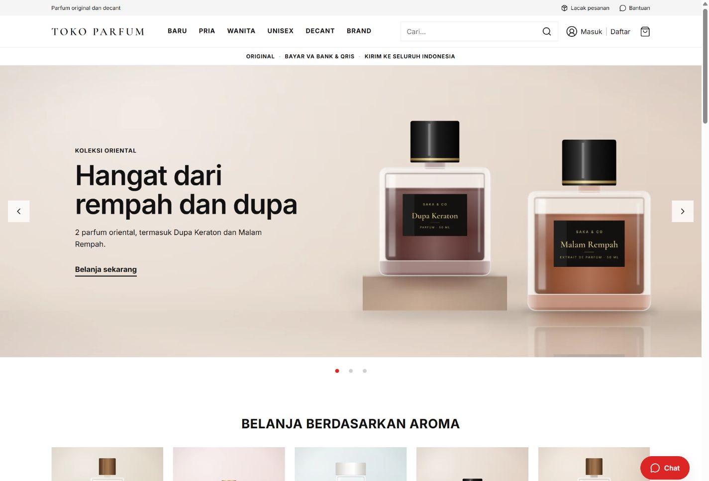

### 2. Katalog — `/katalog`

Daftar parfum dengan penyaringan dan pengurutan. Foto produk memakai latar putih dengan informasi nama dan harga.

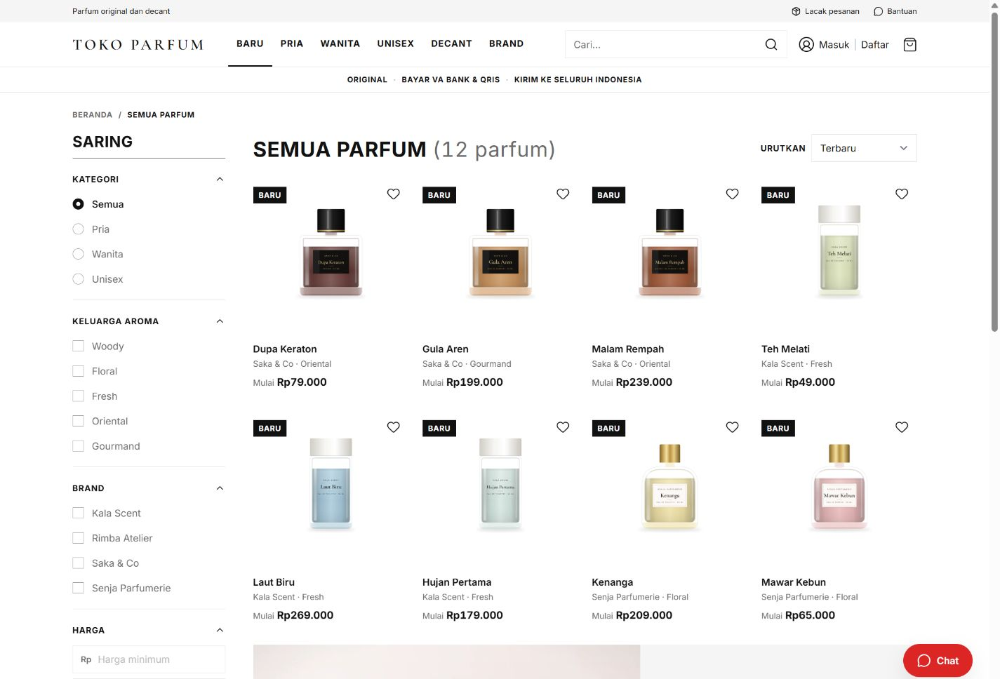

### 3. Detail parfum — `/parfum/hutan-pagi`

Foto, informasi produk, pilihan ukuran, harga, dan tombol tambah ke keranjang.

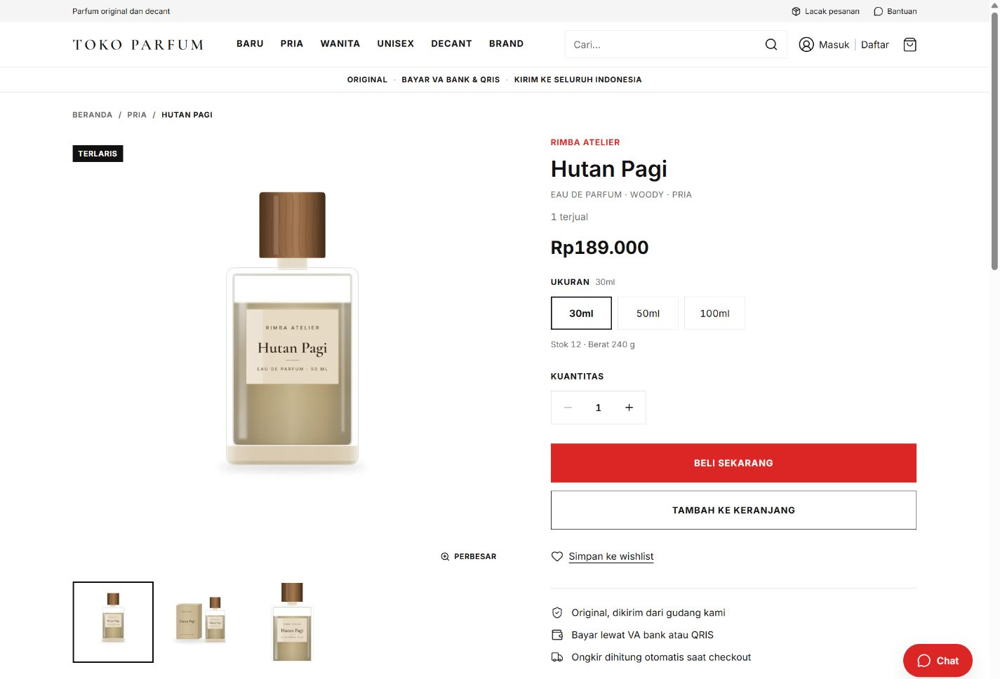

### 4. Masuk — `/login`

Pelanggan masuk ke akun untuk melanjutkan belanja dan mengakses riwayat pesanan.

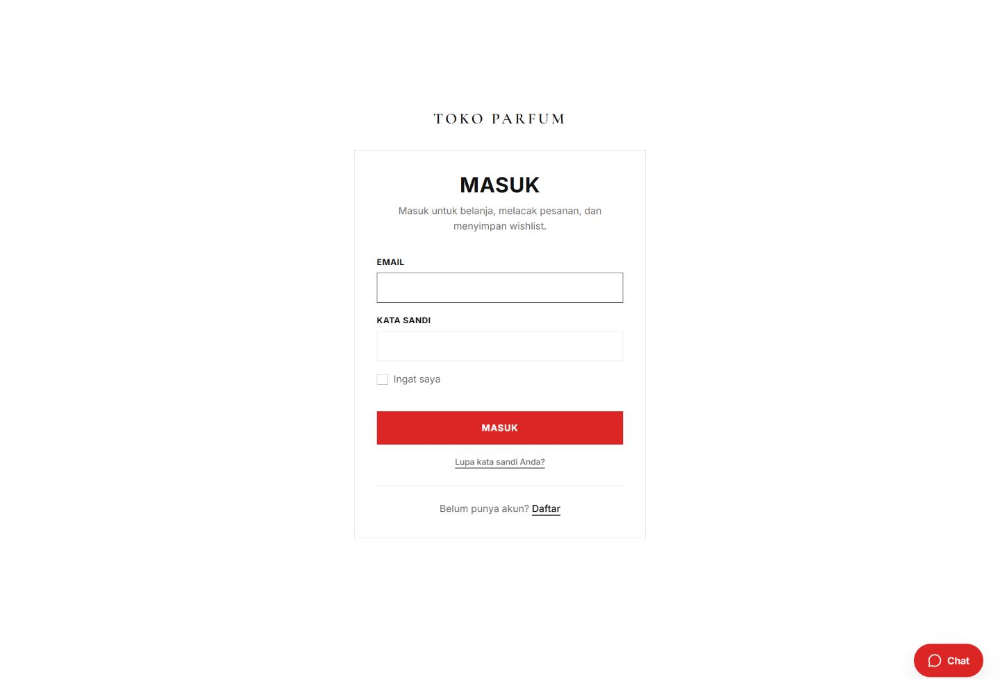

### 5. Keranjang — `/keranjang`

Periksa ukuran, jumlah barang, dan subtotal sebelum melanjutkan checkout.

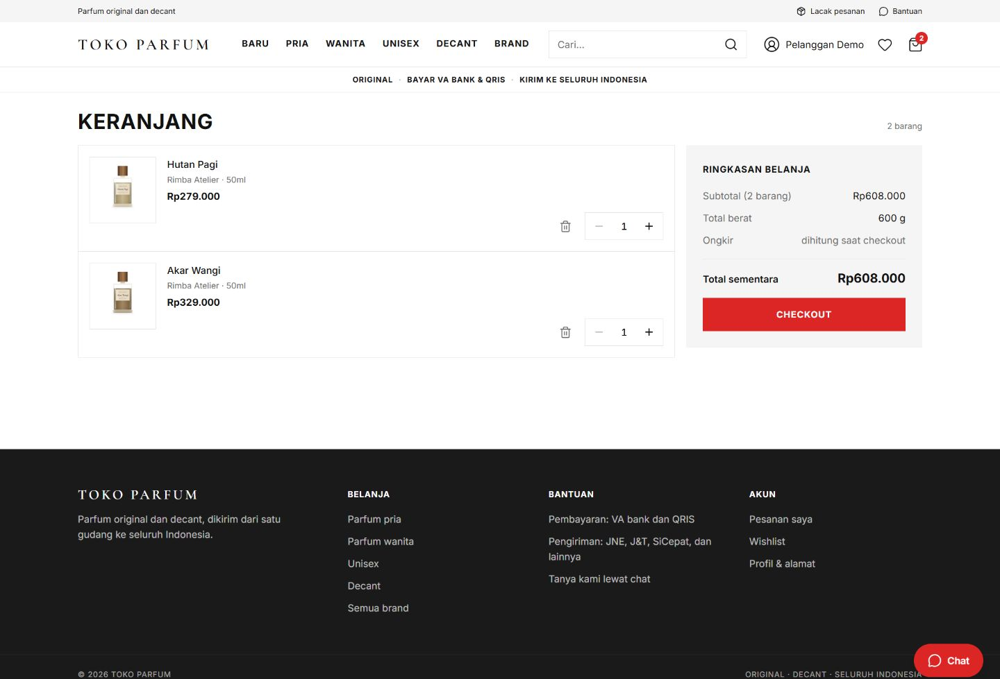

### 6. Checkout — `/checkout`

Pilih alamat pengiriman, kurir, dan pembayaran VA bank atau QRIS. Pilihan kurir tampil dua kolom pada layar lebar. Ringkasan belanja menampilkan subtotal, ongkir, dan total.

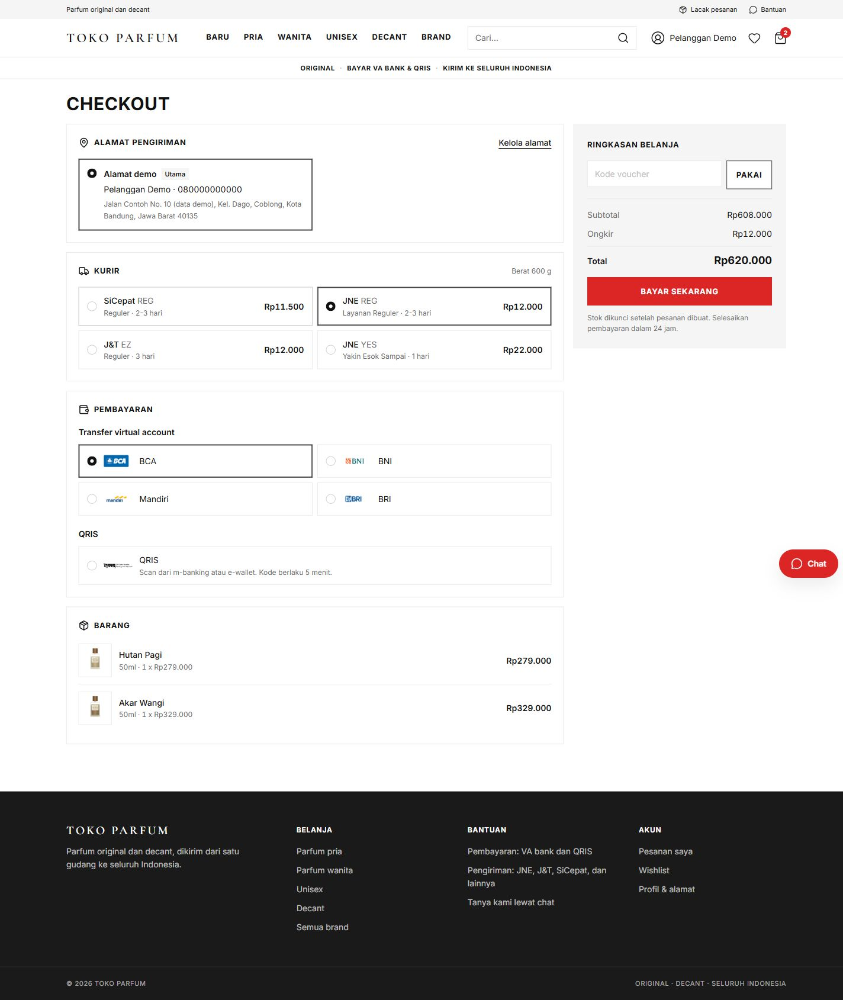

### 7. Pembayaran virtual account — `/pesanan/DEMO-1`

Detail pesanan menampilkan bank, nomor VA, nominal, batas pembayaran, dan instruksi. Nomor pada gambar hanya contoh simulasi.

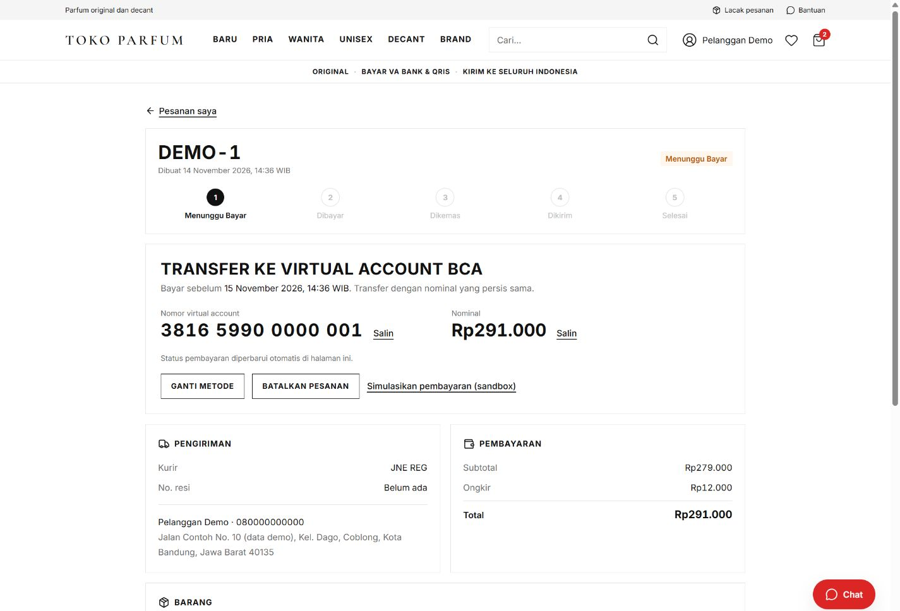

### 8. Pembayaran QRIS — `/pesanan/DEMO-2`

Metode QRIS menampilkan kode dan sisa waktu pembayaran. QR pada dokumentasi berisi teks demo dan tidak dapat dipakai membayar.

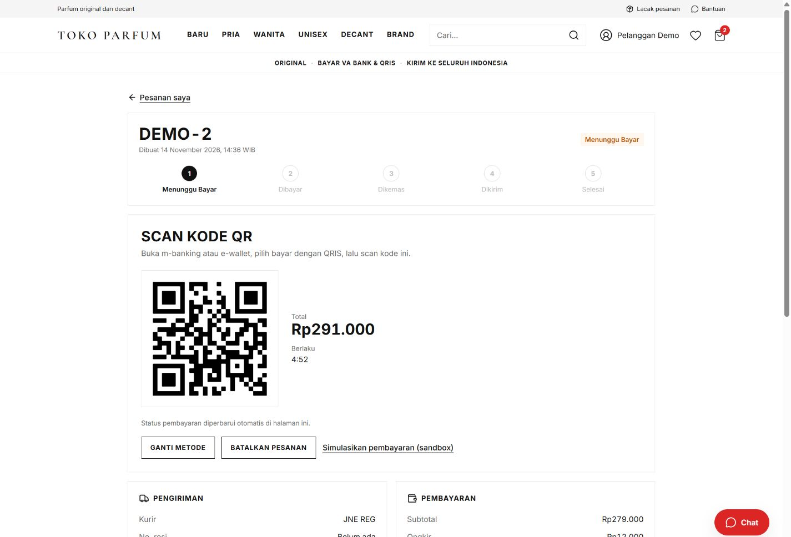

### 9. Pesanan dibayar — `/pesanan/DEMO-3`

Status berubah setelah `PaymentService` memverifikasi jawaban penyedia pembayaran dari server. Membuka halaman sukses di browser tidak menandai pesanan sebagai dibayar.

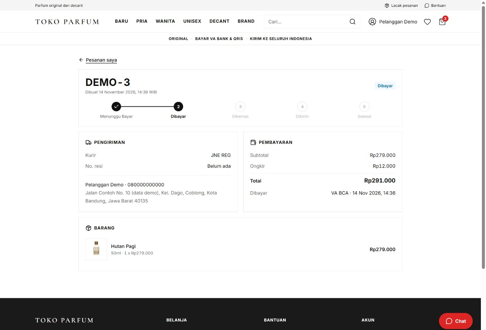

## Halaman akun pelanggan

### 10. Riwayat pesanan — `/pesanan`

Pelanggan dapat membuka detail pesanan untuk melihat pembayaran dan perkembangan pengiriman.

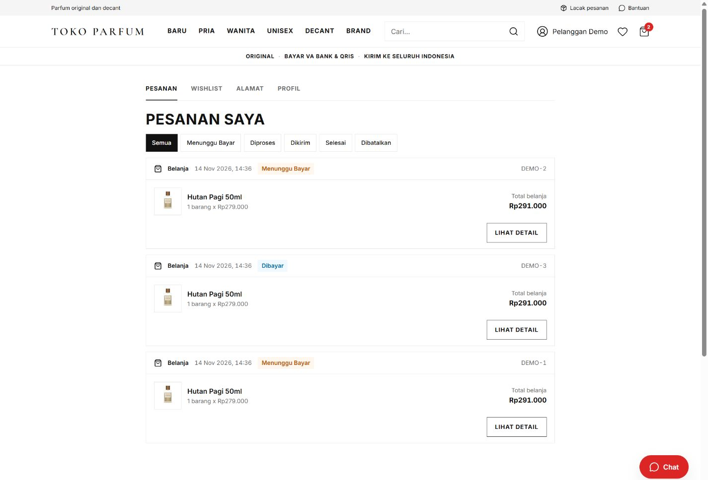

### 11. Wishlist — `/wishlist`

Simpan parfum yang ingin dilihat atau dibeli nanti.

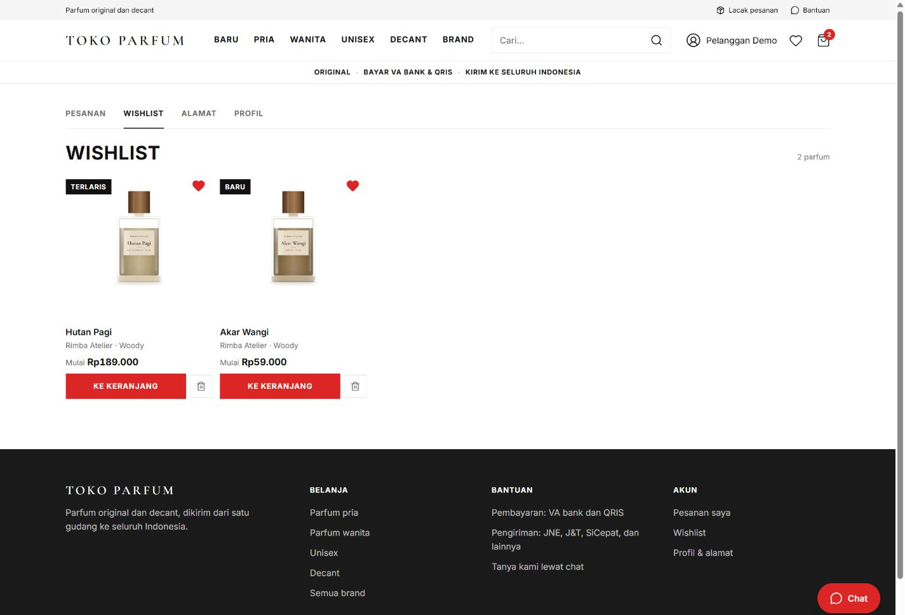

### 12. Alamat — `/akun/alamat`

Tambah, ubah, dan pilih alamat utama untuk pengiriman.

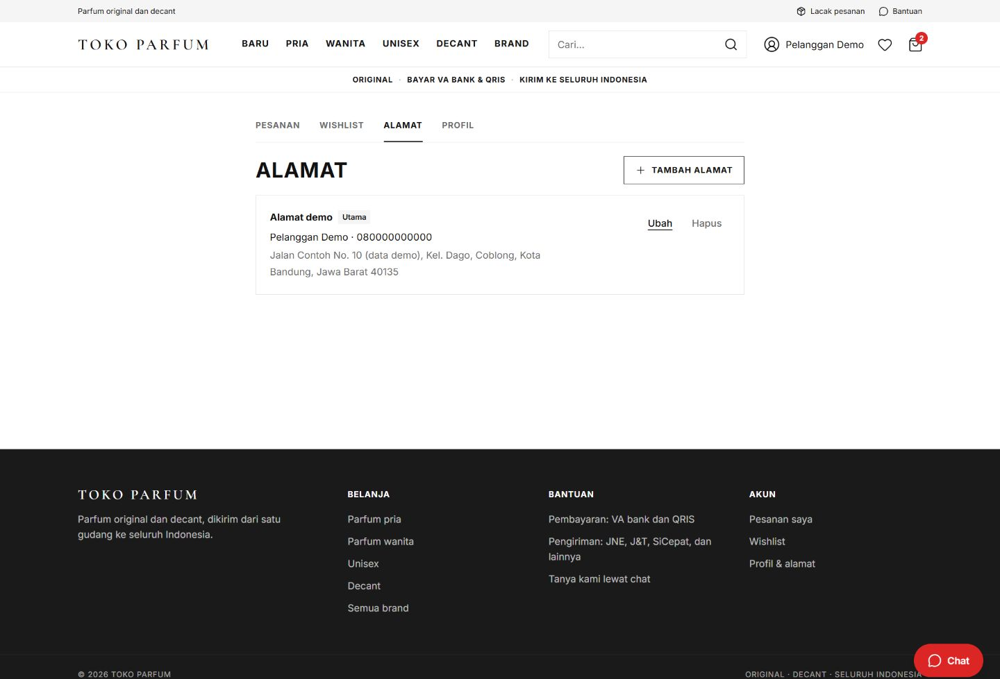

## Panel admin

Panel di `/admin` memerlukan akun dengan peran admin. Untuk instalasi lokal, buat akun melalui `php artisan app:create-admin`; jangan menyimpan kredensial admin di repository.

### 13. Dasbor — `/admin`

Ringkasan aktivitas toko dan menu pengelolaan pesanan, pelanggan, voucher, produk, kategori, brand, FAQ, ulasan, serta inbox.

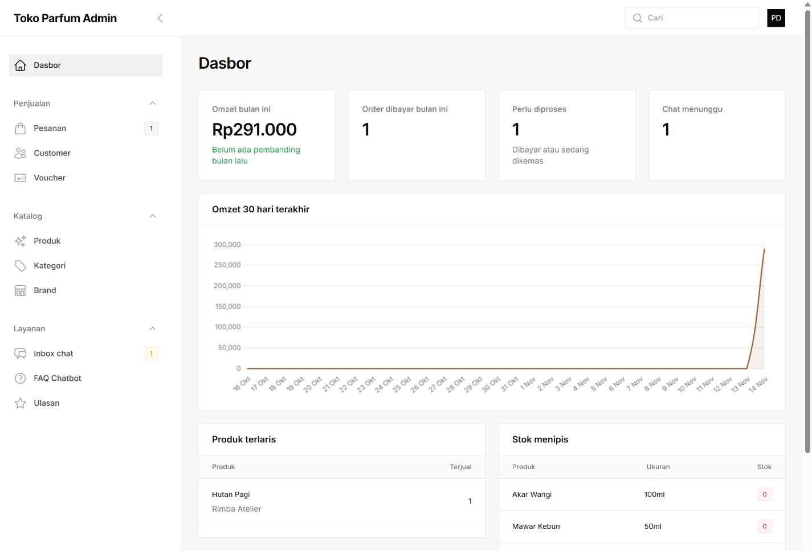

### 14. Inbox chat — `/admin/inbox-chat`

Filter Menunggu, Dibalas, Chatbot, dan Selesai disusun tanpa scrollbar horizontal. Pilih percakapan untuk membaca pesan dan membalas pelanggan.

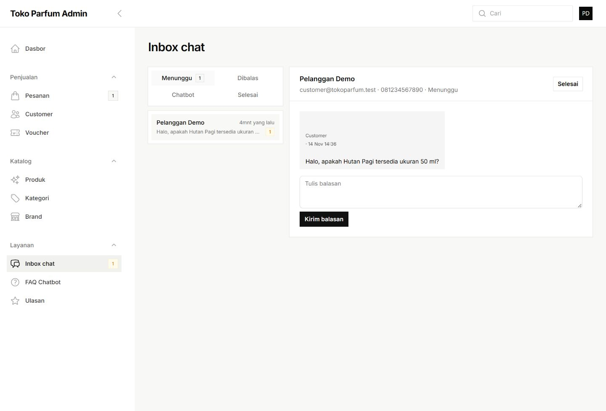

## Tampilan HP

Pada layar sempit, inbox menyusun daftar percakapan dan isi chat ke bawah. Katalog tetap menampilkan dua kolom produk. Contoh berikut diambil pada viewport 390 × 844.

| 15. Inbox admin | 16. Katalog pelanggan |
| --- | --- |
| 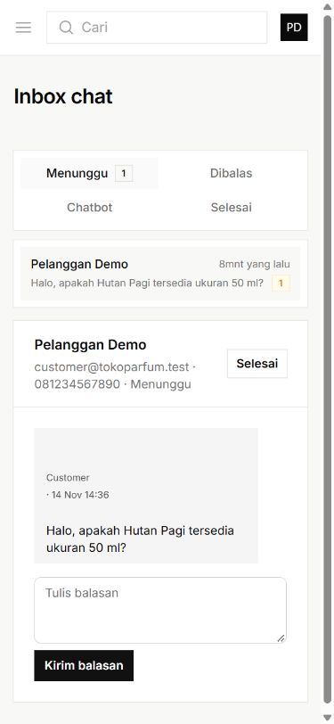 | 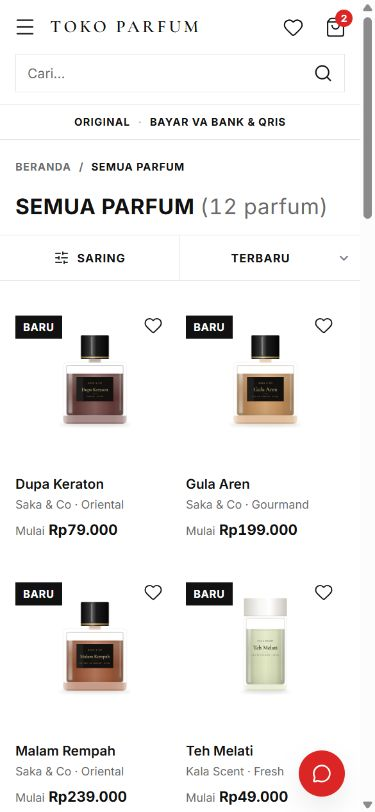 |

## Catatan verifikasi

- Perbaikan inbox diuji pada lebar 360, 390, dan 1366 piksel tanpa overflow horizontal.
- `npm run build` berhasil untuk perubahan inbox.
- Hasil suite setelah perbaikan inbox: **361 test lulus, 2201 assertions**.
- Penambahan galeri ini hanya mengubah dokumentasi dan gambar; tidak mengubah konfigurasi atau logika pembayaran.

Untuk instalasi, pengujian, dan deployment shared hosting, lihat [README](../README.md). Spesifikasi fitur ada di [PRD](PRD.md).
